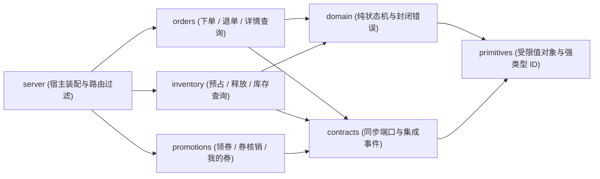

# shopkit

面向多代理并行研发的模块化单体电商参考平台，采用垂直切片、领域驱动建模、读写分离与代码原生黑盒验收测试架构。

## 架构拓扑

系统按无共享限界上下文组织，跨上下文同步协作经由全局 `contracts` 端口与本地短事务外的补偿机制解耦，集成事件落库 `outbox_events` 后通过进程内总线广播。



## 上下文与切片矩阵

| 上下文                                                 | 切片与端口            | 接口契约                                                    |
| :----------------------------------------------------- | :-------------------- | :---------------------------------------------------------- |
| [orders](crates/contexts/orders/context.md)            | `cmd_place_order`     | `POST /api/orders`                                          |
| [orders](crates/contexts/orders/context.md)            | `cmd_cancel_order`    | `POST /api/orders/{order_id}/cancel`                        |
| [orders](crates/contexts/orders/context.md)            | `qry_order_detail`    | `GET /api/orders/{order_id}`                                |
| [inventory](crates/contexts/inventory/context.md)      | `cmd_reserve_stock`   | `POST /api/inventory/reservations` (`StockReservationPort`) |
| [inventory](crates/contexts/inventory/context.md)      | `cmd_release_stock`   | `POST /api/inventory/reservations/{reservation_id}/release` |
| [inventory](crates/contexts/inventory/context.md)      | `qry_sku_stock`       | `GET /api/inventory/skus/{sku}`                             |
| [promotions](crates/contexts/promotions/context.md)    | `cmd_claim_coupon`    | `POST /api/promotions/coupons/{code}/claim` (`CouponRedemptionPort`) |
| [promotions](crates/contexts/promotions/context.md)    | `qry_user_coupons`    | `GET /api/promotions/users/{user_id}/coupons`               |

## 质量门禁

- 编译期类型防呆：`primitives` 强制私有构造与 `try_new`，禁用浮点数 `f32`/`f64` 算账、阻塞标准库调用及 `#[allow]` 消音属性。
- 模块与结构隔离：全仓禁用 `mod.rs` 与内联测试；`ast-grep` 禁止同上下文跨切片引用、读切片引写侧领域包、纯计算管道引入 I/O 库。
- 三层测试网：1 对 1 单元测试、基于 `#[sqlx::test]` 隔离临时库的切片黑盒验收，以及跨上下文端到端旅程测试。
- 主干合并队列：所有 PR 需经 `Merge Gate` 并进入 GitHub Merge Queue 批处理通过后以 Squash 方式合入 `main`。

## 快速开始

启动本地测试数据库并运行全套文档、架构扫描、Clippy、测试与依赖合规校验：

```sh
mise install
mise run db-up
mise run check
mise run openapi
```

导出契约位于 [openapi.json](contracts/openapi.json)，全局架构决策记录位于 [context-map.md](context-map.md) 与 [docs/adr/](docs/adr/0001-vsa-dmmf-cqrs-fusion.md)。

## 贡献与安全

请参阅 [贡献指南](CONTRIBUTING.md) 与 [安全政策](SECURITY.md)。

## 许可证

[MIT](LICENSE) © 2026 Taitide Labs
