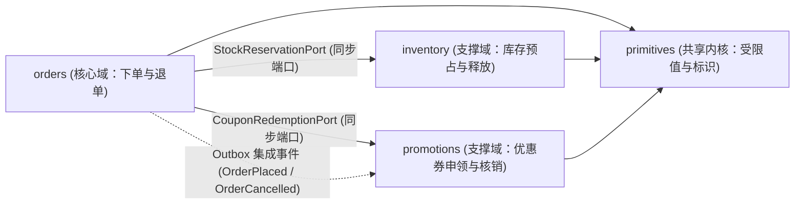

# 上下文地图

电商交易平台围绕核心订单履行链路划分为三个无共享限界上下文，各上下文独立持有持久化表结构与状态模型，仅通过受限原语、同步端口契约与事务性集成事件协作。

## 限界上下文

- [订单上下文](crates/contexts/orders/context.md) — 核心域，负责下单计价、状态转换、退单补偿与交易审计
- [库存上下文](crates/contexts/inventory/context.md) — 支撑域，负责商品可用库存扣减、订单级预占凭证与超时或取消释放
- [优惠券上下文](crates/contexts/promotions/context.md) — 支撑域，负责优惠券批次限额控制、用户领券与满减核销

## 关系模式

- 订单上下文 `[OHS, PL]` -> 库存上下文 `[ACL]`
  - 同步端口：调用 `StockReservationPort::reserve_stock` 预占库存并在落单失败或取消订单时调用 `release_stock` 补偿释放
- 订单上下文 `[OHS, PL]` -> 优惠券上下文 `[ACL]`
  - 同步端口：调用 `CouponRedemptionPort::redeem_coupon` 校验归属并锁定优惠额度，在落单失败或取消订单时调用 `release_coupon` 退回未使用状态
- 订单上下文 <-> 全部上下文 `[SK]`
  - 共享：收敛于 `crates/primitives/` 的 `Money`、`Quantity`、`Sku`、`CouponCode`、`DiscountRule` 与强类型标识
  - 事件：`orders` 本地短事务同步记录 `outbox_events`，随后通过进程内 `EventBus` 广播 `OrderPlaced`、`OrderCancelled` 等集成事件
